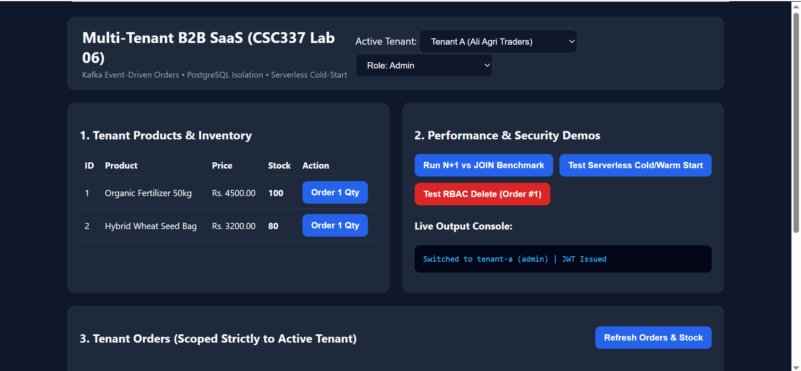

# Multi-Tenant B2B SaaS Platform (CSC337 Lab 06)

A multi-tenant B2B SaaS application built with **Node.js (Express)**, **PostgreSQL (Supabase)**, and **Kafka**, featuring strict `tenant_id` data isolation, JWT authentication with RBAC, composite-indexed query optimization, event-driven order processing, and serverless worker simulation.

## Dashboard Preview



## Key Features

- **Tenant Isolation:** Business tables (`products`, `orders`, `order_items`) are scoped by `tenant_id` and queried using parameterized `WHERE tenant_id = $1` filters.
- **JWT & RBAC:** Issues tenant-aware JWT tokens and enforces role-based access control on sensitive operations such as deleting orders.
- **Query Optimization:** Demonstrates N+1 vs. `JOIN` query performance and uses composite indexing (`tenant_id, created_at DESC`) for tenant lookups.
- **Async Order Processing:** Order creation publishes `OrderCreated` events keyed by tenant and returns `202 Accepted` while consumers/workers process fulfillment.
- **Serverless Worker Simulation:** Provides `/api/v1/serverless/invoice` to inspect cold-start vs. warm-start execution behavior.

## Project Structure

```text
├── docs/
│   └── dashboard-preview.png
├── public/
│   └── index.html
├── sql/
│   └── schema.sql
├── src/
│   ├── consumer.js
│   ├── db.js
│   ├── kafka.js
│   ├── middleware.js
│   ├── server.js
│   └── serverlessWorker.js
├── vercel.json
├── .env.example
└── package.json